# Rewire

Rewire shows, task by task and from public evidence, how exposed the work of an occupation is to
generative AI, and turns that into a plan of real courses paid with PayPal. It is built for
workers in the European Union, the United States and the United Kingdom, and for the training
providers who sell to them.

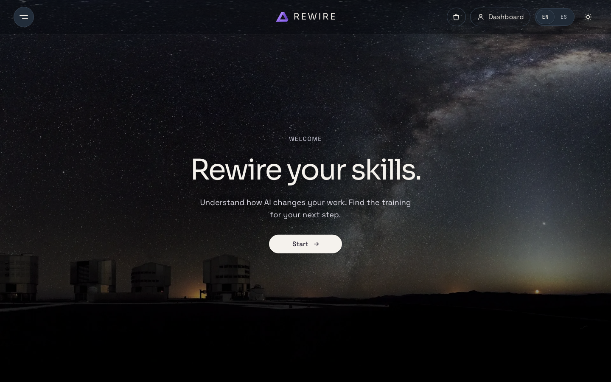

## What is in it

Everything below runs today against the API in this repository.

- **Start with Rex.** A conversational start: describe your work in your own words, Rex proposes
  official occupations (ESCO, O\*NET, SOC 2020), and you pick one and the tasks you actually do.
- **An exposure report by task.** Each task carries the International Labour Organization's 2025
  generative-AI exposure index, its band and the spread between models. Exposure is the technical
  potential of tasks, not a prediction of job loss.
- **A plan of three real courses** chosen from the catalogue for the occupation in the report.
- **A course shop** with about 1,070 real courses in the US and the UK and about 2,150 in the EU:
  969 from the public Microsoft Learn catalogue API, more than 90 hand-picked courses of other providers and,
  in the EU only, 1,084 official training specialties of the Spanish public employment service
  (SEPE). Search and filter by hand, or tell Rex what you want to learn and it picks among
  candidates the server returns.
- **Cart and "Buy now"**: one course, or a basket of up to ten in one PayPal order.
- **A wallet** topped up with PayPal that pays for courses from its balance.
- **Refunds** within 14 days, before a course is completed, to PayPal or back to the wallet.
- **"Ask my employer to pay"**: an invoice sent with PayPal Invoicing that opens the course when
  it is paid in full.
- **A learner dashboard**: radial gauges, a timeline of next steps, payments and refunds in AG
  Grid, and an interactive roadmap on Bryntum Gantt where courses can be moved in time.
- **Tempo, the plan agent**, on the roadmap: say what changed in plain words ("I only have two
  hours a week and cannot start until January") and the server recalculates the plan.
- **A demonstration seller, Sun School**, with its own workspace: an editable catalogue, publishing
  a course of its own, sales, refunds and discount beacons that lower every price of a region for
  a time window. Learners see a running beacon in the shop and on their dashboard.
- **Explore**: each region in data with AG Charts, the occupation table in AG Grid, and an
  "Analyse" view built on AG Studio with an AI analyst.
- **A library** of 75 readings from public institutions, and a plain-language guide, "What is AI".
- **Credits and sources** and **Privacy**: two small pages linked under the copyright, where every
  source keeps its licence, its date and its attribution in one place.
- English and Spanish interface, light and dark themes.

| Courses and Rex                                   | Cart                                         |
| ------------------------------------------------- | -------------------------------------------- |
| 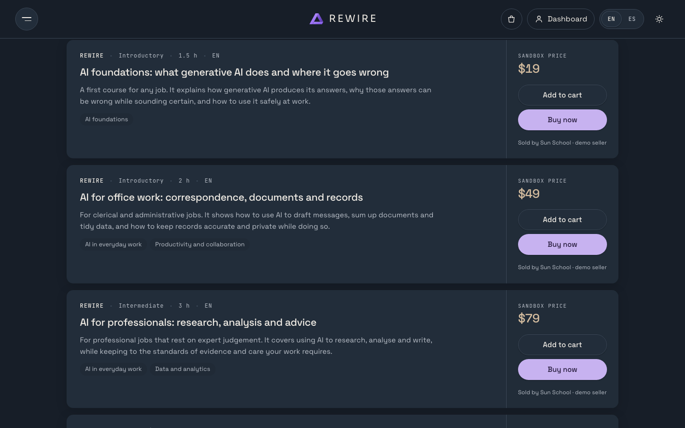       | 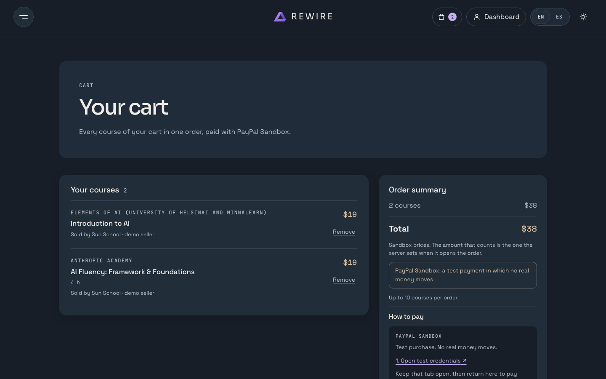            |
| **Exposure report**                               | **Wallet**                                   |
| 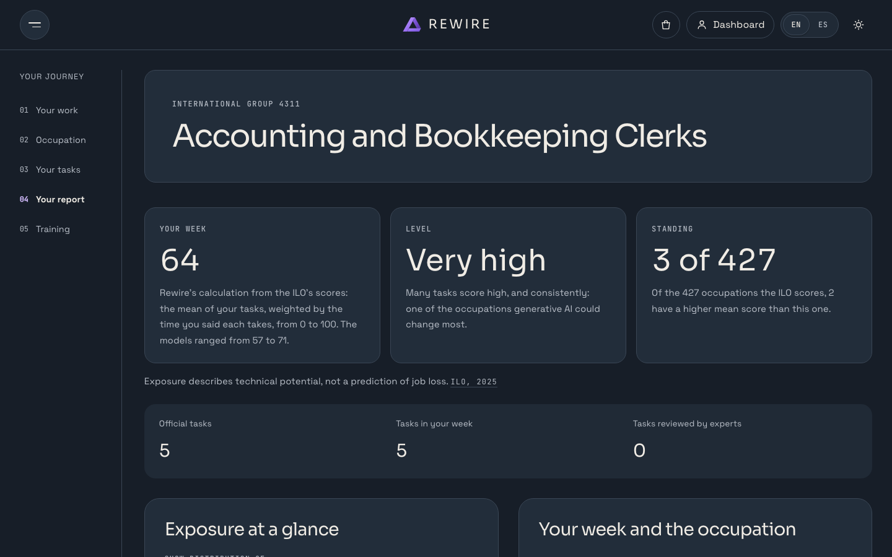     | 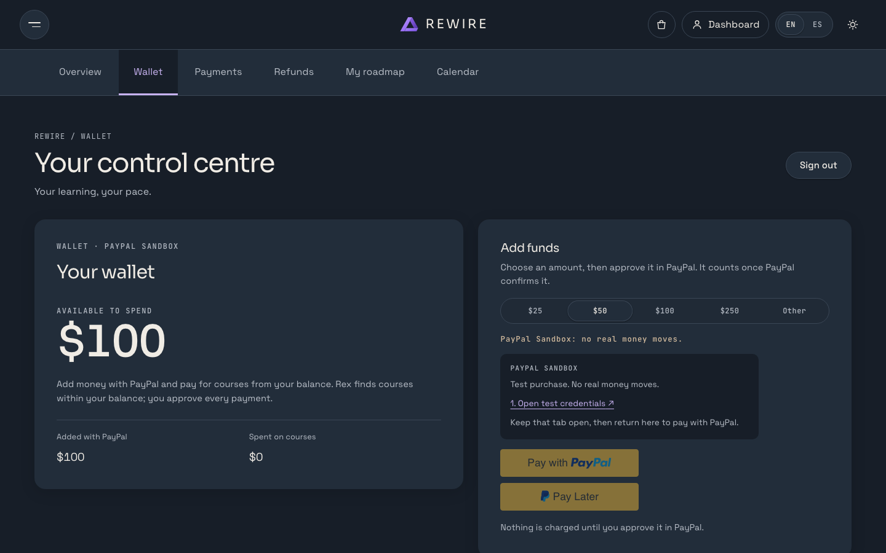        |
| **Learner dashboard**                             | **Roadmap on Bryntum Gantt**                 |
| 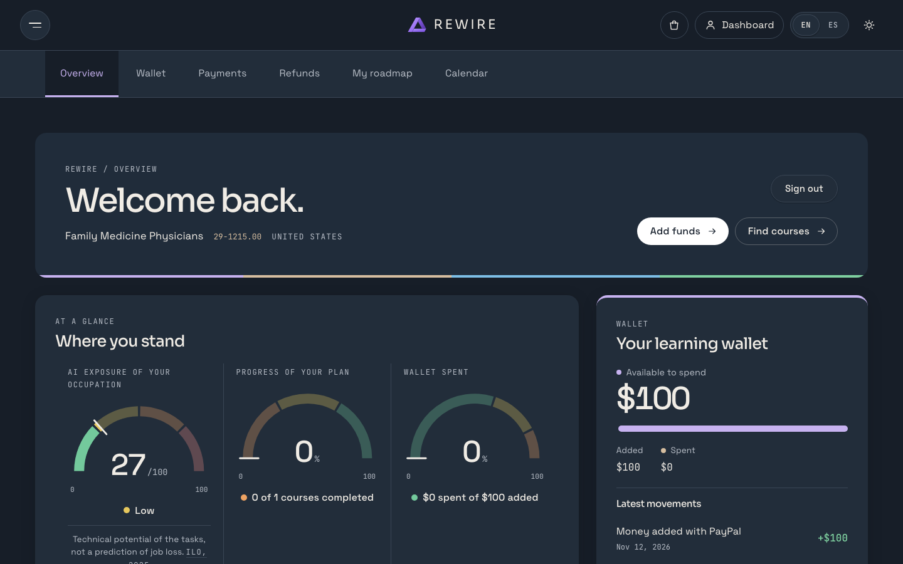       | 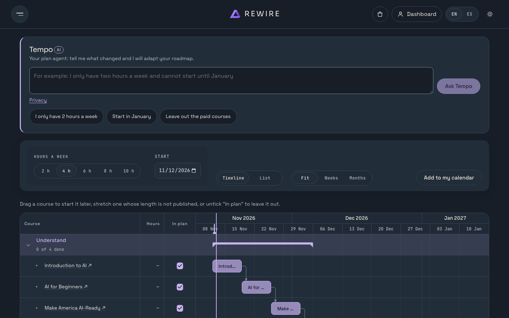      |
| **Sun School, the seller**                        | **Discount beacons**                         |
| 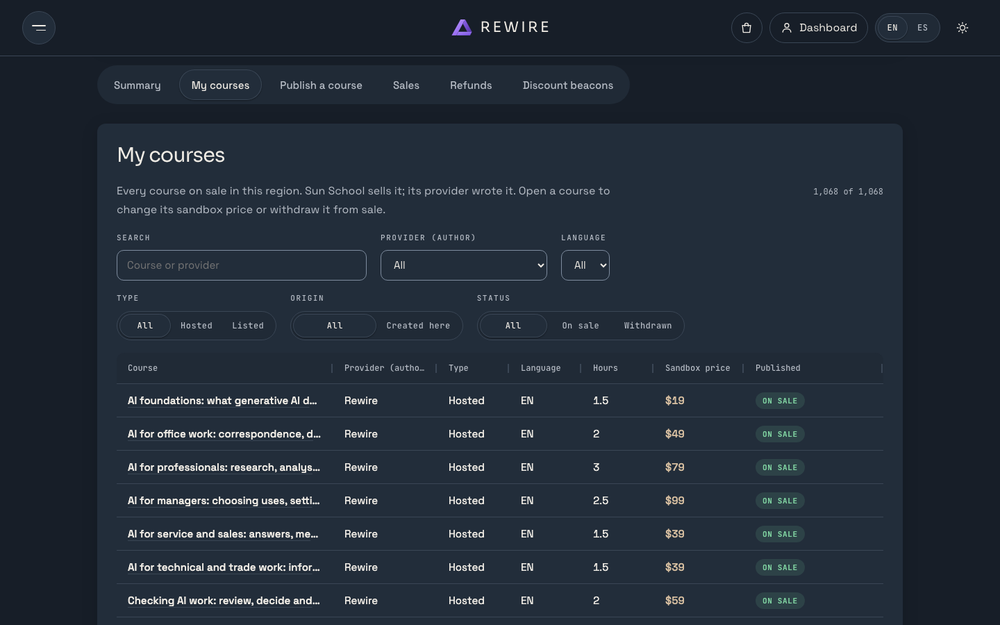 | 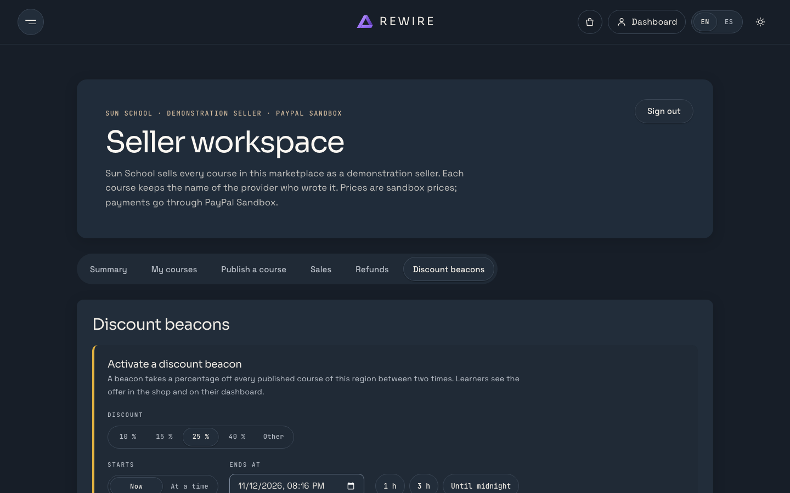 |
| **Explore**                                       | **Library**                                  |
| 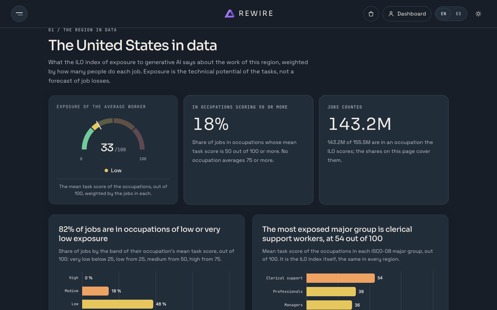      | 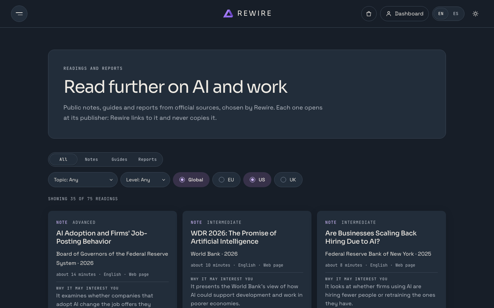      |

## How PayPal is used

All payments run in PayPal Sandbox. The server decides every amount; the browser sends only
course ids and a region. Details and guarantees: [docs/payments.md](docs/payments.md).

| PayPal                                             | What Rewire does with it                                                                     |
| -------------------------------------------------- | -------------------------------------------------------------------------------------------- |
| Orders v2, through `@paypal/paypal-server-sdk`     | Creates and captures the order for one course, a basket of up to ten, or a wallet top-up.    |
| JavaScript SDK v6, through `@paypal/paypal-js`     | The PayPal and Pay Later buttons and the approval window in the browser.                     |
| Captures verified on the server                    | A capture counts only if PayPal echoes the order id and the exact amount and currency.       |
| Payments v2 refunds                                | The 14-day money-back guarantee, with an idempotency key per refund.                         |
| Invoicing v2                                       | "Ask my employer to pay": an invoice to the employer; the course opens when paid in full.    |
| Webhooks                                           | Capture and invoice events, with the signature checked locally against PayPal's certificate. |
| Sandbox demo buyer (`PAYPAL_SANDBOX_DEMO_BUYER_*`) | A fictional sandbox buyer shown at checkout, so a reviewer can approve a test payment.       |

Every write to PayPal carries a `PayPal-Request-Id`, and every payment fact is written to an
append-only ledger in the same transaction that grants or revokes access.

## How AI is used

The engine calculates and the model explains. No score, occupation code, course or price comes
from a model. Details: [docs/ai-guide.md](docs/ai-guide.md).

- **Rex and Tempo** (OpenAI through the Responses API, `apps/api/src/modules/guide`). Rex
  reads a job description and proposes occupations; the server accepts only codes its own search
  returned. Rex explains a report in words, and Tempo changes the study plan through the server's
  own tools; rules in code refuse any figure and any prediction of job loss in their text, and the
  numbers on screen are drawn from the engine.
- **Rex in the course shop** (`apps/api/src/modules/courses`). The server builds a list of
  candidate courses by lexical search; the model orders those candidates and writes one sentence
  for each. Without a model, or when its answer does not pass the checks, the lexical order stands.
- **The analyst in Explore** (`apps/api/src/modules/analyst`). AG Studio runs its agents in the
  browser; the API bounds each turn, with its own body limit and daily token budget, and forwards
  it to the model.

Without an OpenAI key, every part that does not need a model keeps working.

## Sponsor tools

- **AG Grid** (Community): the seller's catalogue, payments and refunds, occupation and task
  tables.
- **AG Charts** (Community): exposure charts in the report, the plan and Explore, and the seller's
  sales.
- **AG Studio**: the "Analyse" view of Explore and its AI analyst. It is a commercial package, not
  covered by this repository's licence; see [docs/deployment.md](docs/deployment.md).
- **Bryntum Gantt** (Community edition): the interactive roadmap of the learner dashboard.
- **PayPal Server SDK** (`@paypal/paypal-server-sdk`) and **PayPal JS SDK** (`@paypal/paypal-js`).

## Run it locally

Requires Node.js 24.11 or later.

```sh
npm ci
cp .env.example .env
npm run dev        # API at http://127.0.0.1:8200
npm run dev:web    # web app at http://127.0.0.1:5200, in a second terminal
```

Open <http://127.0.0.1:5200>, choose a region and a profile (**Individual** or **Business**), and
sign in with the demo account:

- Username: `Rewire`
- Password: `DemoDemoDemo`

These credentials are for Rewire only; they are not a PayPal login.

Every credential in `.env` is optional:

| Variables                                                               | Without them                                                        |
| ----------------------------------------------------------------------- | ------------------------------------------------------------------- |
| `PAYPAL_CLIENT_ID`, `PAYPAL_CLIENT_SECRET`                              | The shop shows its catalogue and sells nothing (checkout is 503).   |
| `PAYPAL_WEBHOOK_ID`                                                     | Payments still settle through the checkout call and reconciliation. |
| `PAYPAL_SANDBOX_DEMO_BUYER_EMAIL`, `PAYPAL_SANDBOX_DEMO_BUYER_PASSWORD` | The checkout shows no sandbox buyer to copy.                        |
| `OPENAI_API_KEY`                                                        | Rex falls back to rules; Tempo and the analyst are off.             |

### PayPal Sandbox credentials in two minutes

1. Sign in at <https://developer.paypal.com>, open **Apps & Credentials** in **Sandbox** and
   create a REST app. Copy its client id and secret into `PAYPAL_CLIENT_ID` and
   `PAYPAL_CLIENT_SECRET`.
2. Under **Sandbox accounts**, create a **Personal** account and use it as the buyer in PayPal's
   window. To have the checkout show it, set `PAYPAL_SANDBOX_DEMO_BUYER_EMAIL` and
   `PAYPAL_SANDBOX_DEMO_BUYER_PASSWORD`; the email must end in `@personal.example.com`.
3. Restart `npm run dev`. Add funds in **Dashboard → Wallet**, or buy a course from **Courses**.

Never use live credentials for this demo. Production and Render deployment:
[docs/deployment.md](docs/deployment.md).

## What is real and what is simulated

- **The courses are real** and belong to their providers. Rewire links to each one and copies none
  of its content. Seven short demonstration courses written for Rewire run inside the app, with
  lessons, a quiz and a certificate.
- **The prices are sandbox prices** set by a fictional seller, Sun School. No provider is paid,
  and Rewire is not affiliated with the providers.
- **Payments go through PayPal Sandbox** and move no real money.
- **Real enrolment in a third-party course** happens on the provider's site.
- **Exposure is the technical potential of tasks**, from the ILO's 2025 index; it is not a
  prediction that anyone will lose a job.
- **The occupational data is official** (ILO, ESCO, O\*NET, SOC 2020 and the labour statistics of
  each region), built into a bundle pinned by SHA-256.

## Verify

```sh
npm run verify
```

`verify` runs formatting, lint, TypeScript, unit and API tests, the production build, data
integrity, unused code, licences, generated documents and the delivery check.

Browser journeys run with `npm run e2e`, against an isolated server with a stand-in for PayPal.

On the day of submission, 12 November 2026, all 84 journeys pass. A real PayPal Sandbox top-up of the
wallet, approved by a sandbox buyer in PayPal's own window and followed by a payment from the
balance, was also run against this build that day.

`npm run e2e:live` makes real Sandbox payments and a refund with a sandbox buyer from `.env`; see
[tests/e2e/live/README.md](tests/e2e/live/README.md).

## Project structure

```text
apps/api/           HTTP API: sessions, catalogue, checkout, wallet, invoicing, seller, AI routes
apps/web/           React app: learner journey, shop, dashboards, Explore, library
packages/contracts/ Zod schemas of the API boundary
packages/engine/    Search, matching and exposure calculations, without I/O
packages/content/   Region profiles, course catalogues, the demo seller and the library
packages/data/      Source processing and the verified data bundle
docs/               Architecture, method, payments, AI, catalogue, data sources, deployment
tools/              Delivery and quality checks
tests/e2e/          Browser journeys
```

## License and credits

The code is released under the [MIT License](LICENSE). Data sources and dependencies keep their
own terms: [docs/data-sources.md](docs/data-sources.md),
[docs/course-catalogue.md](docs/course-catalogue.md) and
[THIRD_PARTY_NOTICES.md](THIRD_PARTY_NOTICES.md). Rewire is an independent adaptation of public
research and is not endorsed by its publishers.

The cover photograph is "360-degree Panorama of the Southern Sky" by ESO/H.H. Heyer, CC BY 4.0,
via Wikimedia Commons; see [apps/web/src/assets/README.md](apps/web/src/assets/README.md).
